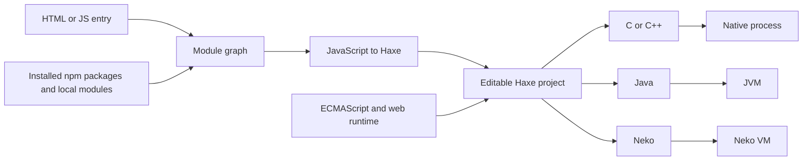

# The general JavaScript compiler

Silicanto has an experimental source compiler for applications whose libraries are not known in advance. It resolves the application and its dependencies, lowers their JavaScript to Haxe functions and module initializers, and lets a payload compile that project. It does not embed Node, a browser, a JavaScript VM, or a copy of the original scripts in the native application.

```sh
npm ci
npm run setup:c
npm run setup:java
npx --no-install silicanto graph tests/fixtures/general/index.html
npx --no-install silicanto emit tests/fixtures/general/index.html --frontend generic --out dist/source
npx --no-install silicanto target dist/source --target cpp --out dist/desktop
dist/desktop/cpp/Sample --asset-root tests/fixtures/general --window
# For a deterministic capture without a window:
dist/desktop/cpp/Sample --asset-root tests/fixtures/general --frames 4 --capture frame.ppm
npx --no-install silicanto target dist/source --target java --out dist/jvm
java -jar dist/jvm/java/Sample.jar --asset-root tests/fixtures/general --window
```

The compiler also accepts a single JS entry, ES modules, CommonJS, and local HTML pages with multiple scripts. Install the application's dependencies using its lockfile before building. Use `--web-root DIR` when relative JS import URLs at a mounted directory's boundary should resolve as they do on a web server. The CLI never installs arbitrary app dependencies. Look at `manifest.json` for module edges, input hashes, host profile and payload; look at `haxe/JsModule*.hx` and `haxe/JsUnit*.hx` for the application and its libraries. Copying the generated project to a new directory and running `silicanto target` requires no original JavaScript.

The library and the application take the same route. A platform payload supplies services that have no JavaScript implementation in the application's source tree:



| Component | Responsibility |
| --- | --- |
| [HTML input](../src/frontend/document.mjs) | Parse script order, inline and external sources, module roots and simple import maps. |
| [Dependency graph](../src/frontend/graph.mjs) | Resolve static import and literal require edges using browser package resolution, including nested dependencies and package exports. |
| [Haxe emitter](../src/frontend/javascript.mjs) | Lower expressions, classes, closures and control flow. Preserve receiver bindings and evaluate JS operands in order. |
| [Compilation units](../src/frontend/units.mjs) | Split large closed functions and literal tables so the JVM and native compilers can consume bundled libraries. |
| [ECMAScript runtime](../runtime/ecmascript/) | Values, objects and prototypes, properties and descriptors, module initialization, typed arrays and collections. |
| [Web host](../runtime/web/) | A DOM/Canvas subset, bitmap, animation frames, local XHR, blobs and image decoding. |
| [Payload registry](../src/targets.mjs) | Select the backend according to the required host capabilities. Canvas uses the software raster payload; Metal is used by the legacy scene payloads. |
| [Legacy Three.js path](../src/legacy/three/) | Retain previous typed builds, packed scenes and the Metal renderer. `--frontend generic` bypasses this code, including for a package named `three`. |

A library is source code; a browser API is a platform service. New language features belong in the compiler or ECMAScript runtime. New drawing, input and resource APIs belong in the web host. A game, library name or upstream filename does not belong in any of those places.

The same canvas can run offscreen or in a desktop window. `--window` presents through AppKit on macOS C++ or Swing on Java. Use `--frames N` for a finite run. C and Neko support the software surface. Supply `--asset-root DIR` to resolve local XHR GET requests, JSON, blobs and image assets. PNG works on all four tested targets. JPEG and platform fonts are available in the C++ and Java desktop builds.

On Apple Silicon, `canvas.getContext("webgl")` provides a WebGL 1 interface in Haxe. A native bridge issues GLES calls to ANGLE using Metal. GLSL compilation, linking, texture uploads, draw calls and framebuffer readback happen on that backend. The first desktop build downloads a pinned, checksum-verified ANGLE distribution. C++ executables load the adjacent `webgl/` directory. The macOS-built Java JAR embeds the ARM64 native libraries. Other JVM platforms retain their Java 2D surface. [ANGLE source](https://github.com/google/angle/tree/a96fca8d5ee2ca61e8de419e38cd577579281c9e) · [Binary distribution](https://github.com/yorickreum/angle-libs/releases/tag/a96fca8)

`npm run test:webgl` builds the same unmodified application for C++ and Java and compares its framebuffer with Chromium. The fixture also checks shader status, pixel readback, font metrics, glyph coverage and JavaScript built-ins.

WebGL 2, complete WebGL 1 conformance, GPU antialiasing and context loss/restoration remain open. The Canvas implementation supports arcs, Bézier curves, platform text and a subset of blending and CSS. Network transport, audio playback, keyboard/pointer input and full CSS layout remain open. The frontend still has gaps in dynamic imports, eval, async functions, generators and ES module cycles.

Run `npm run test:generic` after installing the [native tools](../README.md) and `npx playwright install chromium`. The test bundles only the browser reference. The native builds consume the original classic script, ES modules, CommonJS and JSON through the general compiler. A local PNG is loaded through XHR, turned into a blob URL and drawn into the scene. All four targets are compared with Chromium byte for byte.

The [Phaser 4 compatibility report](compatibility/phaser4/README.md) measures the full upstream gallery on C++ and Java and records the first failing stage per target.
