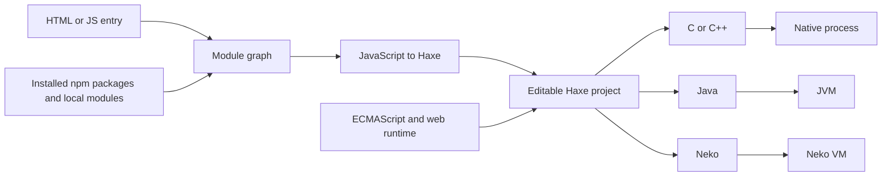

# The general JavaScript compiler

Silicanto has an experimental source compiler for applications whose libraries are not known in advance. It resolves the application and its dependencies, lowers their JavaScript to Haxe functions and module initializers, and lets a payload compile that project. It does not embed Node, a browser, a JavaScript VM, or a copy of the original scripts in the native application.

```sh
npm ci
npm run setup:c
npm run setup:java
npx --no-install silicanto graph tests/fixtures/general/index.html
npx --no-install silicanto emit tests/fixtures/general/index.html --frontend generic --out dist/source
npx --no-install silicanto target dist/source --target cpp --out dist/desktop
dist/desktop/cpp/Sample --asset-root tests/fixtures/general --window
# For a deterministic capture without a window:
dist/desktop/cpp/Sample --asset-root tests/fixtures/general --frames 4 --capture frame.ppm
npx --no-install silicanto target dist/source --target java --out dist/jvm
java -jar dist/jvm/java/Sample.jar --asset-root tests/fixtures/general --window
```

The compiler also accepts a single JS entry, ES modules, CommonJS, and local HTML pages with multiple scripts. Install the application's dependencies using its lockfile before building. Use `--web-root DIR` when relative JS import URLs at a mounted directory's boundary should resolve as they do on a web server. The CLI never installs arbitrary app dependencies. Look at `manifest.json` for module edges, input hashes, host profile and payload; look at `haxe/JsModule*.hx` and `haxe/JsUnit*.hx` for the application and its libraries. Copying the generated project to a new directory and running `silicanto target` requires no original JavaScript.

The library and the application take the same route. A platform payload supplies services that have no JavaScript implementation in the application's source tree:



| Component | Responsibility |
| --- | --- |
| [HTML input](../src/frontend/document.mjs) | Parse script order, inline and external sources, module roots and simple import maps. |
| [Dependency graph](../src/frontend/graph.mjs) | Resolve static import and literal require edges using browser package resolution, including nested dependencies and package exports. |
| [Haxe emitter](../src/frontend/javascript.mjs) | Lower expressions, classes, closures and control flow. Preserve receiver bindings and evaluate JS operands in order. |
| [Compilation units](../src/frontend/units.mjs) | Split large closed functions and literal tables so the JVM and native compilers can consume bundled libraries. |
| [ECMAScript runtime](../runtime/ecmascript/) | Values, objects and prototypes, properties and descriptors, module initialization, typed arrays and collections. |
| [Web host](../runtime/web/) | ECMAScript events, DOM and CSS layout, timers and animation frames, resources, audio, input, Canvas 2D and WebGL bindings. |
| [Payload registry](../src/targets.mjs) | Select a backend for the requested host capabilities. Desktop C++ and Java support a software 2D surface and, on Apple Silicon, WebGL via ANGLE and Metal. |
| [Legacy Three.js path](../src/legacy/three/) | Retain previous typed builds, packed scenes and the Metal renderer. `--frontend generic` bypasses this code, including for a package named `three`. |

A library is source code; a browser API is a platform service. New language features belong in the compiler or ECMAScript runtime. New drawing, input and resource APIs belong in the web host. A game, library name or upstream filename does not belong in any of those places.

The same canvas can run offscreen or in a desktop window. `--window` presents through AppKit on macOS C++ or Swing on Java. Use `--frames N` for a finite run. C and Neko support the software surface. Supply `--asset-root DIR` to resolve local XHR GET requests, JSON, blobs and image assets. PNG works on all four tested targets. JPEG and platform fonts are available in the C++ and Java desktop builds.

On Apple Silicon, `canvas.getContext("webgl")` provides a WebGL 1 interface in Haxe. A native bridge issues GLES calls to ANGLE using Metal. GLSL compilation, linking, texture uploads, draw calls and framebuffer readback happen on that backend. The first desktop build downloads a pinned, checksum-verified ANGLE distribution. C++ executables load the adjacent `webgl/` directory. The macOS-built Java JAR embeds the ARM64 native libraries. Other JVM platforms retain their Java 2D surface. [ANGLE source](https://github.com/google/angle/tree/a96fca8d5ee2ca61e8de419e38cd577579281c9e) · [Binary distribution](https://github.com/yorickreum/angle-libs/releases/tag/a96fca8)

### Native desktop APIs on Apple Silicon

Both the C++ executable and the Java desktop JAR implement the following interfaces. The translations share the same Haxe host. Native libraries supply the GPU, media, network and layout operations.

| Interface | Implementation and verification |
| --- | --- |
| WebGL 1 | ANGLE on Metal compiles GLSL, draws to framebuffer attachments, negotiates multisampling and recreates lost contexts. The test compares all 1,536 pixels of a triangle with an analytic result. Upstream OGLES rendering tests compare reference and test shaders at 500 × 500 pixels. It checks context loss events, resource invalidation and restoration. |
| WebGL 2 | A separate EGL ES 3 context exposes the WebGL 2 core methods. The integration test exercises GLSL ES 3.00, instancing-related state, unsigned uniform reflection, vertex arrays, buffer subranges, samplers, queries, synchronization, 3D texture storage and framebuffer-layer readback. |
| CSS and DOM | litehtml computes block, inline, flex and table layout. Core Graphics and Core Text paint the page. Local stylesheets and their imports are build inputs. Selectors, layout rectangles, a subset of resolved CSS properties, inline style changes and media queries use the native document. |
| Input | AppKit and Swing feed pointer, wheel, key and resize events into Haxe. DOM listeners implement capture, bubbling, cancellation and pointer capture. Window-queue tests post AppKit and AWT events. A frame-indexed input trace also exercises DOM dispatch inside the application. |
| Media | HTML Audio decodes and plays supported files through AVFoundation. A generated WAV exercises loading, actual playback and the ended event. |
| Network | URLSession handles HTTP and HTTPS for fetch, XHR and image/audio resources. The desktop test starts a loopback server and checks response status, headers, payloads, errors and cancellation. WebSocket uses the native URLSession task for WS/WSS and supports subprotocol negotiation, text and binary messages and close frames. The test exercises WS over loopback. |

For pixel evidence from an application's own process, pass `--timeline frames.json 1,4,12 --frames 12`. Each record contains dimensions, a SHA-256 of the RGBA framebuffer and a uniform-color flag. Use `--capture-page page.ppm` to include DOM and CSS, `--input events.json` to replay events and `--realtime` for wall-clock media tests. With `--window`, AppKit or Swing presents an interactive window.

```sh
npm run test:generic
npm run test:webgl
npm run test:webgl-conformance
npm run test:webgl-render -- --target cpp
npm run test:webgl-render -- --target java
npm run test:css -- --out dist/css-results.json
npm run test:desktop
```

The generic test checks exact pixels on C, C++, Java and Neko. The Khronos runners check 136 WebGL 1 method names and 296 numeric constants and cover 178 shader build cases and 775 pixel comparisons in the WebGL 1 OGLES group. The CSS runner compares static self-contained WPT HTML pages against their paired references on the native C++ target. It reports uniform references separately and returns a nonzero status on differences. Run `npm run test:webgl-pages -- --version 1.0.4 --target cpp --out dist/webgl1-pages.json` or select `--version 2.0.1` and `--target java` to run the upstream page lists. Each page must translate, build, execute, report assertions, and notify completion. The runner records the first failed stage. The complete suites cover validation, rendering, robustness and browser lifecycle behavior. The desktop layout engine uses litehtml and Taffy for block, flex and grid layout. The Grid payload supports fractional and implicit tracks, repeat, minmax, gaps, numeric line placement and named areas. Stylesheet insertion, deletion and declaration edits feed the same native layout and paint path. The CSS results include failures in positioned grid children, subgrid and grid lanes. The desktop audio interface covers media elements. Web Audio graphs and streaming fetch bodies are separate APIs. Unsupported ECMAScript features include general dynamic imports, top-level await and generators. The native expression evaluator supports lexical reads, property access, method calls, arithmetic, comparisons and short-circuiting. Evaluating a string containing declarations, assignments or arbitrary statements remains unsupported. The existing C and Neko software canvases have a smaller host surface.

The [native desktop report](compatibility/native-desktop/README.md) contains the C++ and Java gallery timelines, the CSS reference pairs and the Khronos results. Use the [gallery runner](../tests/phaser4/README.md) to reproduce the timelines. The [historical report](compatibility/phaser4/README.md) preserves the earlier fourth-frame comparison.

### Async JavaScript

The compiler lowers ordinary async functions and methods to Promise continuations before generating Haxe. The emitted project includes the native Promise scheduler. Plain ECMAScript applications drain their microtask queue after the entry modules finish. Desktop applications also drain it between event callbacks. The `test:async` command builds and runs the same module on C, C++, Java and Neko and checks the order of continuations, thrown values, `finally`, `Promise.all` and `Promise.race`. [Build-time transform](https://github.com/rpetrich/babel-plugin-transform-async-to-promises)
